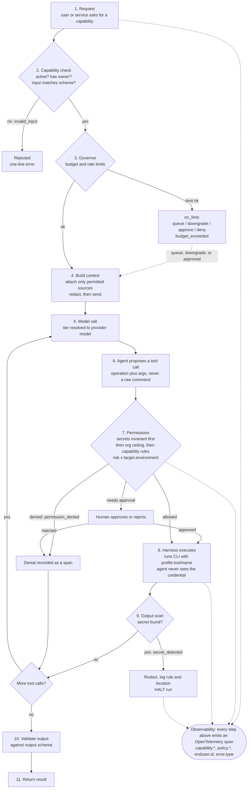

# Governing AI Agents: One Standard, Any Provider

Team meeting · about 15 minutes

---

## The problem

- Teams use Claude, Copilot and more. Each has its own config format.
- Nobody can answer: *Who owns this agent? What can it touch? What did it cost? What did it do?*
- Troubleshooting agents will run `newrelic` and `octopus` against real environments.

**We need one answer that works across providers.**

---

## The idea

Five questions, five small specs, one root object.

| Question | Standard |
|----------|----------|
| What can be asked for? | **Capability interface** |
| What gets sent? | **Context templates** |
| How much? | **Token governors** |
| What can it do? | **Agent permissions** |
| What crossed, what was recorded? | **Observability** |

---

## The capability is the root

One manifest per capability. Everything hangs off it.

```yaml
name: troubleshooting
owner: platform-team@example.com
model: { tier: balanced }
context: context/troubleshooting.md
governor: governors/troubleshooting.yaml
permissions: permissions/troubleshooting.yaml
```

**One name, one owner, one audit key.**

---

## How a request flows



---

## Flow, step by step

| # | Step | What happens | Defined in | Failure |
|---|------|--------------|------------|---------|
| 1 | Request | Caller names a capability and supplies inputs | `capabilities/` | n/a |
| 2 | Capability check | Must be `active`, have an owner, and inputs must match the schema | `schemas/capability.schema.json` | `invalid_input` |
| 3 | Governor | Budget and per-developer limits checked; `on_limit` decides: queue, downgrade, approve or deny | `governors/` | `budget_exceeded` |
| 4 | Build context | Template resolves `attach` sources. Only sources the permissions allow. Redacted before send. | `context/` | `permission_denied` |
| 5 | Model call | Tier (`fast/balanced/deep`) resolves to a provider model | `models/tiers.yaml` | n/a |
| 6 | Tool proposal | Agent picks an operation from a tool descriptor, with args. No raw commands. | `permissions/tools/` | `invalid_input` |
| 7 | Permissions | Secrets invariant, then org ceiling, then capability rules. Default deny. Target comes from the harness. | `permissions/` | `permission_denied` |
| 8 | Execute | Harness runs the CLI using the named profile. Credentials stay outside the model's view. | tool `auth` block | `auth_failed`, `tool_unavailable` |
| 9 | Output scan | Scanner checks output before the model sees it | `permissions/invariants.yaml` | `secret_detected` (halts) |
| 10 | Validate output | Result checked against the output schema | capability `outputs` | `invalid_input` |
| 11 | Return | Result goes to the caller | n/a | n/a |

**Throughout:** each step emits a span with `capability.name`, `capability.owner`, `enduser.id`, `policy.decision` and `error.type`. Denials are recorded like successes.

---

## 1. Capability interface

- Typed inputs and outputs
- Model **tier** (`fast | balanced | deep`), not a model ID. A model change touches one file.
- Lifecycle: `draft | active | deprecated`, with semver
- **No owner, no capability.** "Nobody has decided this."

---

## 2. Context templates

What gets sent, declared up front:

```markdown
---
attach: [diff, CONTRIBUTING.md, style-guide]
---
Review this diff against our style guide.
```

- A template can attach **only** what its permissions allow
- Redaction runs **before** anything leaves
- What was attached is recorded

---

## 3. Token governors

```yaml
budget: $400 / month
limit: 20 requests / developer / day
on_limit: queue        # queue, don't deny
```

- On limit: `queue | deny | downgrade | approve`
- Scope: developer, team, capability, org
- The standard says what a limit **means**. A gateway does the counting.

---

## 4. Agent permissions

- **Default deny.** Rules are written in CEL.
- Not Kubernetes-only: works for `newrelic`, `octopus`, `git`
- The agent never sends a raw command. It picks an **operation** with a **risk** class: `read | write | destructive`
- The harness decides the target environment, never the agent

> Read anywhere. Write only in dev. Prod needs a human.

---

## 5. Observability

One trace, not another log. OpenTelemetry GenAI conventions.

```
span: execute_tool deployment.redeploy   ERROR
  capability.name     troubleshooting
  enduser.id          <harness>
  target.environment  prod
  policy.decision     approval_required
  error.type          permission_denied
```

- Metadata always. Content opt-in.
- **Denials are recorded too.**

---

## The secrets rule

> Agents may be told **where** a secret lives. They never access, view or handle one.

- Manifests hold references only: `profile:newrelic/readonly`
- The harness runs the CLI with that profile. The agent never holds a credential.
- Every tool's credential store is **auto-denied**
- Output is scanned. A detection **redacts, logs and halts**.
- This outranks every capability. Nothing can override it.

---

## Honest about enforcement

| Level | Meaning |
|-------|---------|
| **L1** | Documented |
| **L2** | Validated by script |
| **L3** | Gateway-enforced |

Every rule says `advisory` or `enforced`, so you know what is really guaranteed.

Rules only **narrow** from org defaults to capability. Deny wins.

---

## Built to be portable

- `AGENTS.md` is the single source
- One script generates `CLAUDE.md` and Copilot instructions
- Adopts existing standards: AGENTS.md, Agent Skills, OpenTelemetry, MCP
- We only invented the capability manifest and its permission and budget fields

---

## What exists today

- Five specs plus JSON Schemas
- Two worked examples: `code-review`, `troubleshooting`
- A validator that checks schemas, owners, evals, narrow-only permissions and secret literals
- Stubs for `skills/` and `agents/`

```bash
python3 -I scripts/validate.py   # OK: 0 error(s)
```

---

## Not in scope

- **The bootstrapper** (installs tools, sets up each user's credentials) is separate and not governed by this
- **The enforcer** (gateway or harness) comes later
- If setup is wrong, the run fails with one line: `auth_failed: profile newrelic/readonly rejected`

---

## Decisions we need

1. **Where does `enduser.id` come from?**
   Bootstrapper, SSO/OIDC at a gateway, or OS/git identity. Field is required; source is pluggable.
2. Who reviews permission and budget changes?
3. Which capability goes first on L3 enforcement?

---

## Next steps

1. Pick the `enduser.id` source
2. Fill in real model IDs in `models/tiers.yaml`
3. Add first real capabilities beyond the two examples
4. Build skills and agents against the capability contract
5. Choose an enforcer for L3

**Questions?**
